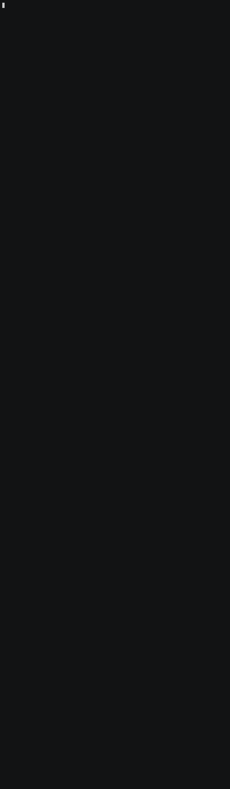

# DBMS Research Knowledge Graph

**20,211 nodes. 53,761 edges. The 1,053 open problems of database systems research, with the
papers, people, institutions, algorithms, systems, bounds and gaps behind them, from one
pinned source.**

Built from the [DBMS Research catalog](https://github.com/samyama-ai/dbms_research)
(35 topics, CC BY 4.0) at commit `5fff7f7`, for [Samyama Graph](https://github.com/samyama-ai/samyama-graph).
Every node and edge is read from a catalog page or a reviewable project list and carries
its source URL.

<a href="LICENSE"></a>



*Ten questions on the loaded graph, recorded live with `demo/record.sh`; each answer is tagged with
what it rests on (parsed from the page, one of our rules, a computed link, or no data).*

---

We asked the graph: *"Which papers are cited by the most problems?"*

```cypher
MATCH (p:Problem)-[:CITES]->(paper:Paper)
RETURN paper.title AS paper, count(p) AS problems
ORDER BY problems DESC LIMIT 5
```

*Foundations of Databases* comes first, cited by 65 problems. All 48 questions in
[docs/scope.md](docs/scope.md) are answered and checked against the raw pages in the
[question report](docs/question-report.md): 17 correct, 8 consistent, 20 answered with a
documented limit, 3 refused by design, 0 wrong.

## Build and check

```bash
python -m venv .venv && source .venv/bin/activate
pip install -e ".[dev,rdf]"
python -m etl.download_data                    # catalog at the pinned commit -> data/ (+ lock file)
python -m etl.source_parser                    # pages -> build/source_catalog.json
python -m etl.local_graph build-catalog-candidate \
  --catalog build/source_catalog.json \
  --output build/dbms_research_kg.schema-candidate-v6.sqlite
G=build/dbms_research_kg.schema-candidate-v6.sqlite
python -m etl.local_graph verify --graph $G    # schema, ids, endpoints, provenance, 7 alignments
python -m etl.quality --graph $G               # 18 content criteria
python -m etl.audit --graph $G                 # 4 taxonomies, 12 code lists, 6 standards
python -m etl.question_check                   # the 48 scope questions
python -m pytest -q
```

### Load it into Samyama

```bash
docker run -d --name samyama-dbms -p 127.0.0.1:8094:8080 ghcr.io/samyama-ai/samyama-graph:latest
python -m etl.loader --catalog build/source_catalog.json --url http://127.0.0.1:8094 --load   # ~2.5 min
python -m demo.demo --url http://127.0.0.1:8094                                             # the narrated demo
python -m etl.snapshot export --url http://127.0.0.1:8094   # -> snapshots/dbms-research-kg.sgsnap + manifest.json
```

Without `--load` the loader prints the load plan and writes nothing. The loader creates the
indexes in [schema/dbms_research_kg.cypher](schema/dbms_research_kg.cypher) and fails unless every
label and relationship type holds exactly the planned count.

### Or skip the build: load the snapshot

The built graph is shared inside the team as `dbms-research-kg.sgsnap` (9.5 MB), outside git like the
other KGs' snapshots. [snapshots/manifest.json](snapshots/manifest.json) records its SHA-256, the commit
that built it, the engine version and the count of every label and relationship type. Put the file
in `snapshots/` and import it into a **fresh** server; import appends, so `etl.snapshot import` refuses
a non-empty server and checks every count against the manifest afterwards.

```bash
python -m etl.snapshot import --url http://127.0.0.1:8094
``` `python -m mcp_server.server` exposes
read-only tools over MCP for the engine set in `mcp_server/config.yaml`.

## Schema

| Nodes (16 labels) | | Edges (17 types) | |
|---|---:|---|---:|
| Person | 4,454 | RELATED_TO (computed) | 8,686 |
| FutureDirection | 3,825 | AUTHORED_BY | 7,000 |
| Paper | 2,679 | CITES | 6,157 |
| ResearchDirection | 2,496 | ACTIVE_ON | 5,536 |
| Bound | 2,106 | STATE_OF_ART | 4,058 |
| Problem | 1,053 | CLOSING_REQUIRES | 3,825 |
| Gap | 1,053 | CLASSIFIED_AS | 3,689 |
| System | 982 | HAS_RESEARCH | 2,496 |
| Venue | 677 | APPEARED_AT | 2,609 |
| Algorithm | 585 | HAS_BOUND | 2,106 |
| Concept | 90 | RESTS_ON | 1,987 |
| Institution | 82 | IN_MODEL | 1,953 |
| TaxonomyTerm | 77 | IN_TOPIC, HAS_GAP, FROM_SOURCE | 1,053 each |
| Topic | 35 | AFFILIATED_WITH | 469 |
| ComputationModel | 16 | GENERALIZES | 31 |
| DataSource | 1 | | |

- [docs/schema.md](docs/schema.md): labels, edges, provenance, code lists
- [docs/standards.md](docs/standards.md): 7 ontology alignments, 4 taxonomies, 12 code lists, 6 standards
- [schema/conformance.json](schema/conformance.json) and [schema/dbms_research_kg.ttl](schema/dbms_research_kg.ttl): the machine-checked schema and the ontology
- Reports: [quality](docs/quality-report.md), [audit](docs/audit-report.md), [questions](docs/question-report.md)
- Logs: [phase 1](docs/phase1-log.md), [phase 2](docs/phase2-log.md), [phase 3](docs/phase3-log.md)

### The 2026-09 reference graph

`python -m etl.local_graph build --snapshot <path>` imports the published snapshot
(`kg-snapshots-v10`, default path `~/dbms-research.sgsnap`) into its own SQLite file for
comparison. It keeps snapshot provenance and is not this graph.

## Structure

```
etl/          # download, parse, extract, build, check (quality, audit, questions)
schema/       # conformance spec and ontology
mcp_server/   # MCP server exposing the KG
benchmarks/   # benchmark queries
docs/         # design notes, reports and logs
tests/        # pytest
```

Data source licence: CC BY 4.0 (the catalog). Code licence: Apache 2.0.
